

<a href="https://deusespr.github.io/Sloth-Mod/">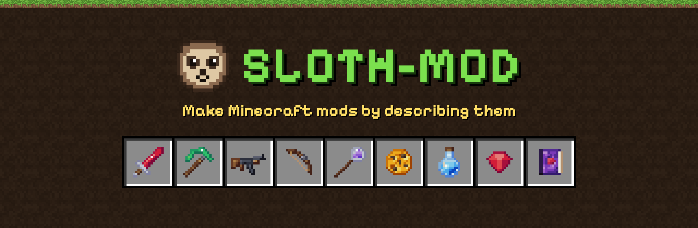</a>

<h3>Describe a Minecraft mod in plain English. Sloth-Mod plans it, writes it, builds it and gets it ready to play.</h3>

Free for Windows · works with any AI, cloud or local · no coding, no Java setup

<a href="https://github.com/DeusesPR/Sloth-Mod/releases/latest">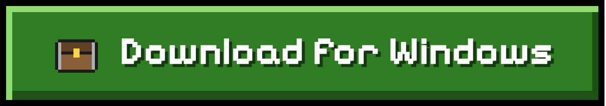</a>

[Website](https://deusespr.github.io/Sloth-Mod/) · [Showcase](#showcase) · [First mod in 3 steps](#your-first-mod-in-3-steps) · [Versions and AIs](#what-it-works-with) · [Install](#install) · [Help](#help-and-feedback) · [Support](#support-sloth-mod)

 

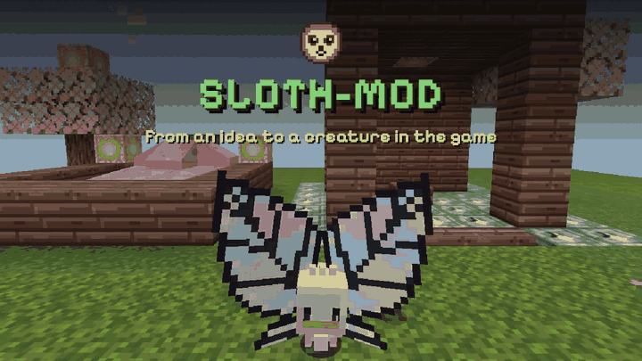

An idea, alive in the game, in 30 seconds with no sound: sample screens from the app and real pictures from Minecraft.

## What it does

- **Builds mods from a sentence.** Items, blocks, mobs or a whole game-changing mod. The AI shows a plan you approve, writes the mod, builds it and repairs its own build errors.
- **Draws the art and makes the sounds.** A built-in engine makes the textures, 3D models, mob skins and sound effects, with 614 kinds of sound. You pick your favourite version of each, and the Edit panel and pixel editor let you change them afterwards without the AI.
- **Lets you test before anything is kept.** One button starts Minecraft with your mod. Then you keep it, ask for a fix or undo it.
- **Lets you change what the AI made, by hand.** How a creature's parts move, its parts, and its rules as plain sentences, with no code (new in 1.3).
- **Manages your mods too.** Browse Modrinth, install mods, modpacks, resource packs and shaders, and keep game profiles for Fabric, Quilt, Forge, NeoForge and vanilla.

## New in 1.3

- **A whole world from one sentence.** Describe a theme and get blocks, creatures and items that fit together (Fabric 26.3 for now).
- **Change how it moves.** Pick a part of a creature and choose flap, wag, spin and more.
- **Change its parts.** Add horns or wings, give it a longer tail, take a part away.
- **Rules in plain sentences.** "When you right-click, do this", changed with pick lists.
- **Wings from your own picture.** Use a picture you drew or picked as a fairy's wings.
- **Dragons.** Tame, ride and fly dragons in five looks, and adjust how they move (Fabric 26.3 for now).
- **Better looking creatures.** Real feathered and leathery wings, and a fairy with butterfly wings.
- **Ready-to-paste commands** in the player guide, a **Suggest an improvement** button, and a small **"Made with Sloth-Mod"** credit line that you can switch off.
- Many fixes.

## Showcase

Everything here was drawn by Sloth-Mod's own art engine, the one that makes the art in your mods. No image generator, no Minecraft art, nothing touched up by hand. You can turn each one yourself, and hear the sound maker, on the [website](https://deusespr.github.io/Sloth-Mod/#showcase).

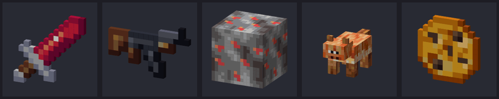

<table>
  <tr>
    <td width="50%" align="center">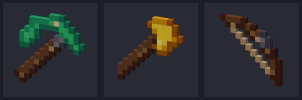 <b>Tools and weapons</b></td>
    <td width="50%" align="center">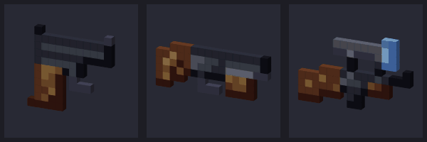 <b>Guns</b></td>
  </tr>
  <tr>
    <td colspan="2" align="center">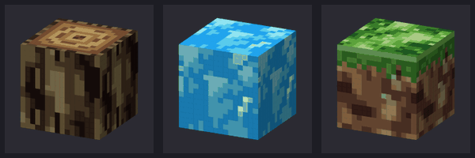 <b>Blocks</b></td>
    
  </tr>
</table>

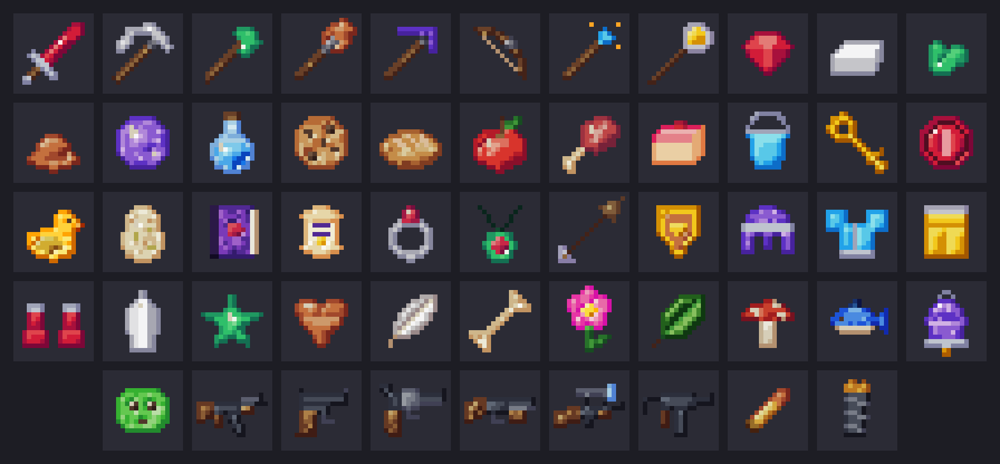 
<b>Every item shape the engine knows.</b> You choose the material and the colors.

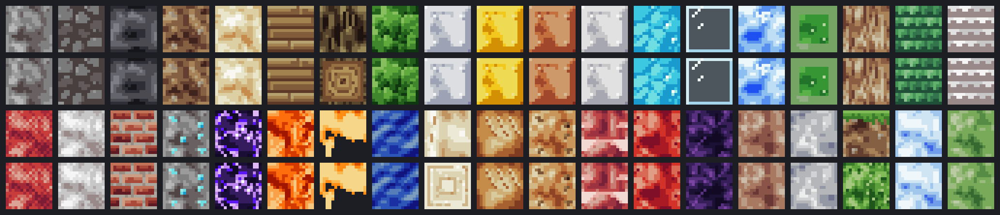 
<b>Block materials, side and top.</b> They tile without seams.

### Creatures made with 1.3, in the game

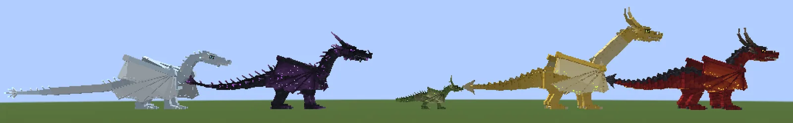 
<b>Five dragons.</b> On the <a href="https://deusespr.github.io/Sloth-Mod/#creatures">website</a> you can look at dragons and a fairy from four sides.

<table>
  <tr>
    <td width="50%" align="center">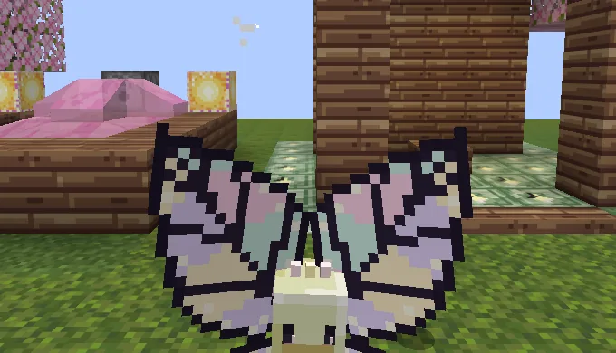 <b>A fairy with butterfly wings</b></td>
    <td width="50%" align="center">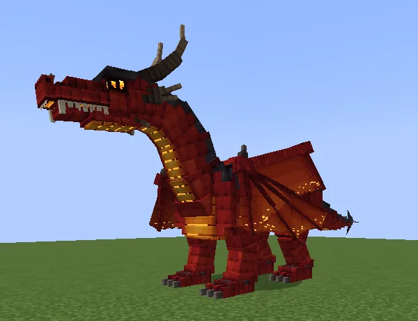 <b>A dragon with membrane wings</b></td>
  </tr>
  <tr>
    <td colspan="2" align="center">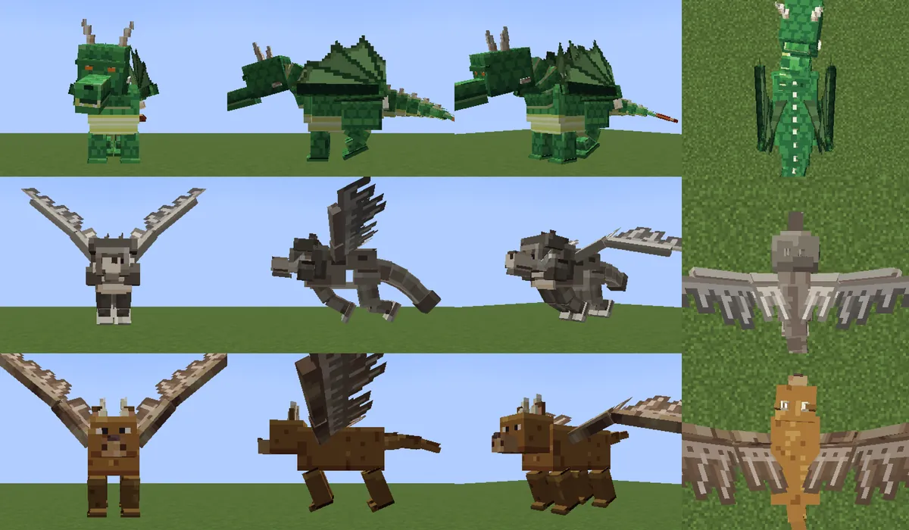 <b>Leathery and feathered wings</b></td>
  </tr>
</table>

## Your first mod in 3 steps

1. **Describe it.** Click **Create New Mod**, pick a Minecraft version and type what you want, for example "a ruby sword that sets mobs on fire". Sloth-Mod asks a few clickable questions and shows a plan.
2. **Pick the art.** You get a few versions of each texture, 3D model and sound. Click the ones you like.
3. **Test it in Minecraft.** One button starts the game with your mod. Then answer "Did it work?": keep it, say what is wrong so the AI fixes it, or undo.

<table>
  <tr>
    <td width="50%" valign="top">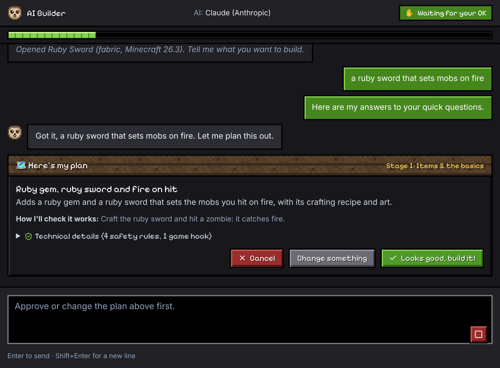 <b>A plan you approve.</b> Nothing is built before you say so.</td>
    <td width="50%" valign="top">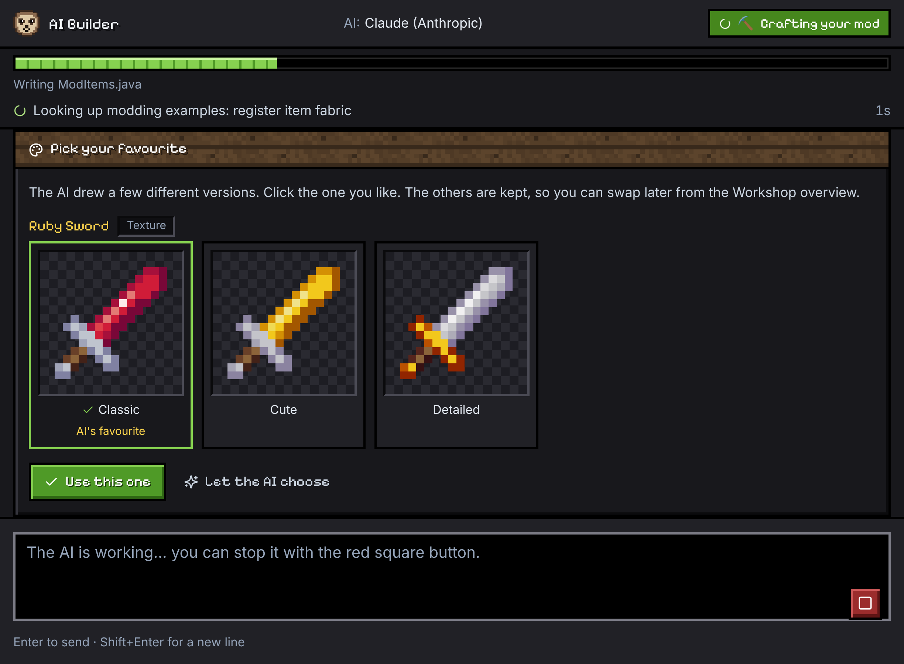 <b>Pick your favourite.</b> The others are kept for later.</td>
  </tr>
  <tr>
    <td width="50%" valign="top">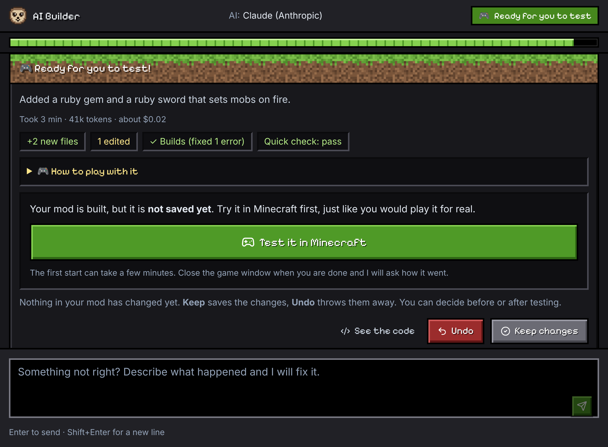 <b>Ready for you to test.</b> Your mod is saved only when you keep it.</td>
    <td width="50%" valign="top">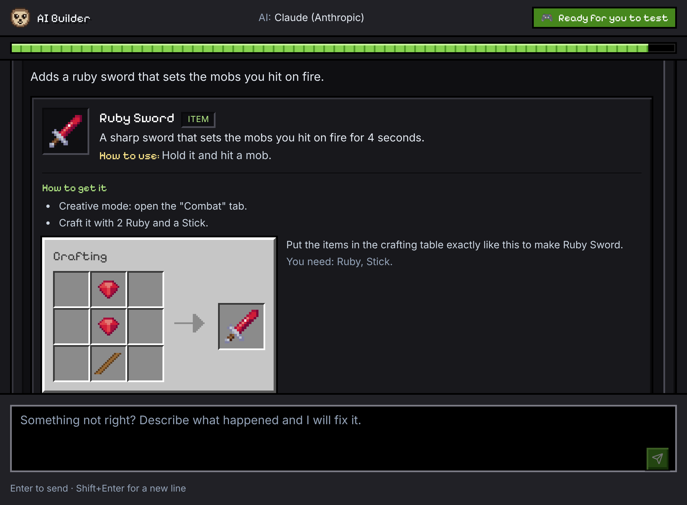 <b>A player guide</b> with crafting panels drawn like the game.</td>
  </tr>
  <tr>
    <td width="50%" valign="top">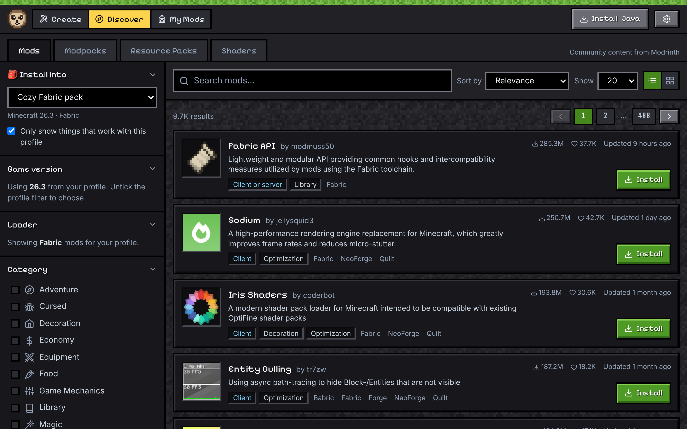 <b>Discover.</b> Mods, modpacks and shaders from Modrinth.</td>
    <td width="50%" valign="top">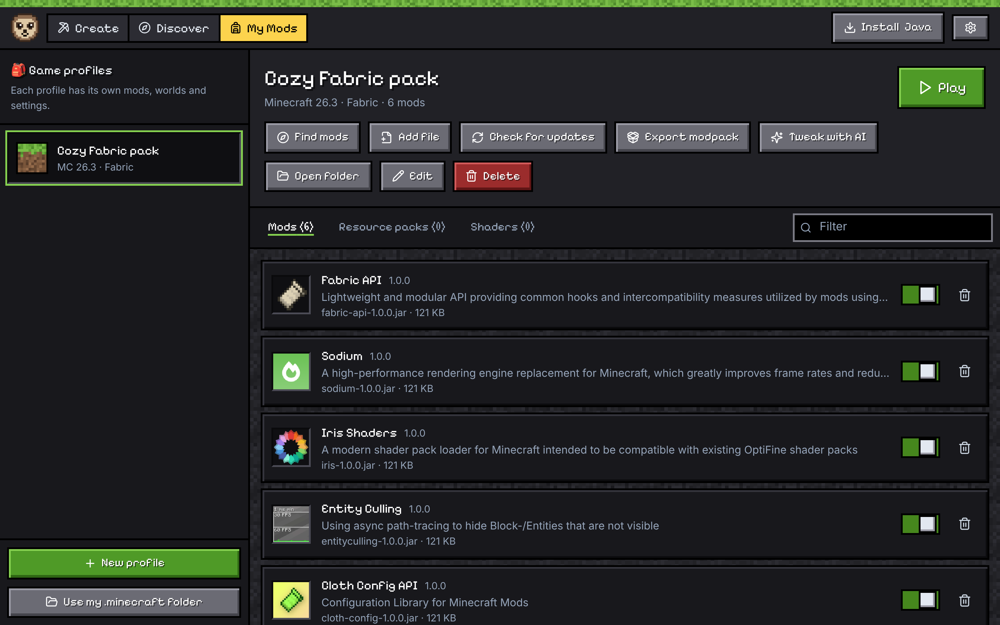 <b>My Mods.</b> Game profiles, on/off switches, updates and Play.</td>
  </tr>
</table>

## What it works with

**Minecraft versions** it can build mods for:

| Minecraft | Fabric | NeoForge | Forge |
|:---|:---:|:---:|:---:|
| 26.3, 26.2, 26.1 | ✓ | ✓ | |
| 1.21.1 | ✓ | ✓ | |
| 1.20.1 | ✓ | | ✓ |

Where new things land:

| | Versions | What to expect |
|:---|:---|:---|
| **New things first** | Fabric 26.3 | Everything new is built and proven here first |
| **Supported** | NeoForge 1.21.1 · Forge 1.20.1 · Fabric 1.21.1 · Fabric 1.20.1 · NeoForge 26.3 | Works and gets fixes; new things arrive later, in batches |
| **Maintained** | Fabric and NeoForge 26.1, 26.2 | Keeps working, gets fixes only |

Small updates arrive often; the app offers them by itself, and your mods, settings and keys stay as they are.

The right Java and Gradle are downloaded by the app. It never touches the Java on your PC. The mod manager also handles Quilt and vanilla profiles.

**AI providers.** Use the one you like:

| Kind | Providers |
|:---|:---|
| **Cloud** | Claude, OpenAI, Gemini, Grok, DeepSeek, Qwen, OpenRouter, Mistral, Groq, Kimi, GLM, MiniMax, Together, Fireworks, Cerebras, NVIDIA NIM, Hugging Face |
| **Local** | LM Studio, Ollama or any OpenAI-compatible server |

Your AI provider may charge you; Gemini and Mistral have free tiers, OpenRouter has free models, and a local AI costs nothing. Every provider has a **Get an API key** button with a note on cost, **Test this AI** checks that it can really drive the app, and you can set a spending limit.

## Install

1. Download [`Sloth-Mod_1.2.2_x64-setup.exe`](https://github.com/DeusesPR/Sloth-Mod/releases/download/v1.2.2/Sloth-Mod_1.2.2_x64-setup.exe) (or pick a version on the [releases page](https://github.com/DeusesPR/Sloth-Mod/releases)) and run it. It installs for your user only, with no admin prompt.
2. **Why Windows shows a warning.** Sloth-Mod is free and not paid-signed, so Windows SmartScreen may show a blue "Windows protected your PC" box. That is normal for a free app. Click **More info**, then **Run anyway**. Only do this for an installer from this repository's Releases page. More in [PRIVACY.md](PRIVACY.md) and [SECURITY.md](SECURITY.md).

You need Windows 10 or 11 (64-bit), about 4 GB of free disk space, internet for the first setup, and Minecraft Java Edition to play what you make. The app updates itself and keeps your mods, settings and keys.

## Where Sloth-Mod is going

Not available today, and built step by step: campaigns with missions, quests and characters, cutscenes and dialogue, and making it easier on cheap and free AI. No dates, on purpose.

What stays: free, Windows, works with cheap or free AI (including AI on your own PC), a compatibility check against your modpack, and safety checks on AI-written code. If you use Sloth-Mod today, nothing breaks and updates keep coming through the app. Tell us what you want to make in the [Discussions](https://github.com/DeusesPR/Sloth-Mod/discussions), or use **Report a problem** in the app.

## Status

**What works in this version (1.2.2):** mods are built with real Gradle and loaded by a real test server on all 10 supported Minecraft/loader versions; each new mod is started and tried out on a real server before you see it; the game window opens and shows a test mod on Fabric 26.3, NeoForge 1.21.1 and Forge 1.20.1; staffs and wands answer a quick click and charge when held; custom keys work on Forge 1.20.1; the sound maker, Minecraft's own sounds and "Use my own sound", the Edit panel, the pixel editor and the Blockbench export/import work.

**Still being polished:** the newest additions (guns, vehicles, wearables, new animations and sounds) are still being fine-tuned in real play. The safety check is a strong guardrail, not a guarantee: only play mods you trust. The installer is not paid-signed, so Windows SmartScreen may show a warning.

## More details

<b>Everything it can do</b>

 

- **Describe, plan, build, test.** The AI asks only what it needs, shows a plan you approve, writes the mod in a sandbox, builds it, repairs build errors, runs quick checks and ends with "Ready for you to test".
- **Art picker.** Several different designs of every texture, 3D model and mob. The others are kept so you can swap later. A pixel editor and a Blockbench export/import let you change them by hand.
- **Sound maker.** 614 kinds of sound (creatures, weapons, magic, materials, machines, interface, ambience, music), made in the app, checked for clicks and clipping, and added as real mod sounds.
- **How-to-play guides.** Every mod gets a player guide with crafting panels, drop and spawn info, ready-to-paste commands and a mod icon.
- **Fast builds and quick edits.** A simple mod takes about two AI turns, and "Make the squeak louder" is just as quick.
- **Edit panel.** Change sizes, colours, numbers and sounds of what the app made, how its parts move, its parts and its rules, with a live preview and no AI.
- **Update to a new Minecraft version.** One run moves your mod to a newer version of the same loader (or Forge to NeoForge) and keeps your art, sounds and hand edits.
- **More things it can build.** Creatures that fly, swim or can be ridden, guns, vehicles, wearables, enchantments, music discs and armor trims.
- **Big project mode.** An approved design, a 20 to 50 step roadmap and a project map; one tested step at a time.
- **Add-ons.** Make a mod that builds on another mod from Modrinth.
- **Spending limit.** Per-mod and daily limits with an optional PIN, and a cost readout for every run.
- **Mod manager.** Modrinth search and installs, game profiles, updates, `.mrpack` export, and Play through the official launcher.
- **Modpack compatibility check.** A throwaway server tells you whether your new mod works with the pack's mods.
- **Crash explainer, version history, share and publish** (export a `.jar` with a readme, or publish a draft to Modrinth).

<b>Safety and privacy</b>

 

- **A guard reads the AI's code and the build files.** Before every build, AI-written code is scanned for things a mod should never do, like launching programs, opening web connections or touching files outside the game folders. The build files are checked too, locked while a mod is made, and only source files can be added to your project. A blocked build tells you why.
- **Nothing is kept until you say so.** The AI works on a copy of your mod. You test it, then keep or undo. Older versions stay in History.
- **No accounts, no tracking.** No sign-up, no telemetry, no analytics. The only thing added to your mods is a small "Made with Sloth-Mod" credit line, which you can switch off. Your requests and mod files go only to the AI provider you choose, or nowhere with a local AI. Downloads contact Modrinth, Mojang and the loader sites, and the update check contacts GitHub. If "Let the AI look things up online" is on (the default), the AI may read a short summary from Wikipedia or the Minecraft wiki while planning. The full list is in [PRIVACY.md](PRIVACY.md).
- **Keys stay on your PC.** API keys live in Windows Credential Manager, never in files or logs. Sloth-Mod never sees your Microsoft login; the official launcher handles it.
- **Honest limits.** Mods are programs and the guard is a safety net, not a guarantee. Code that passes the guard still runs with your Windows rights. Only play mods you trust. How to report a security problem: [SECURITY.md](SECURITY.md). Terms in plain words: [DISCLAIMER.md](DISCLAIMER.md).

<b>Questions and answers</b>

 

**Is it free?** Yes. Free to download and use, and the mods you make are yours ([terms](LICENSE)). Your AI provider may charge; free tiers, OpenRouter's free models and local AIs exist.

**Do I need to code?** No. You describe what you want and click through a few choices. If you like code, the Workshop view has an editor and diffs.

**Which AI should I use?** Any listed provider. Bigger models make bigger mods with fewer repairs. **Test this AI** in Settings checks yours.

**Is the Windows warning normal?** Yes. Sloth-Mod is free and not paid-signed, so Windows warns about it like any new app. Make sure you downloaded it from this repository's [Releases page](https://github.com/DeusesPR/Sloth-Mod/releases/latest).

**Mac or Linux?** The installer is Windows only.

**Is this an official Minecraft product?** No. It is a fan-made tool, not approved by or associated with Mojang or Microsoft, and it contains no Minecraft assets.

Longer answers are on the [website](https://deusespr.github.io/Sloth-Mod/#faq).

<b>What has been tested, and what has not</b>

 

- Tested on a real Windows PC with a real AI (DeepSeek): a mod made from one sentence was built, checked on a test server and played in Minecraft (Fabric 26.3), plus quick edits, Undo and Share. Every supported loader and version is also built for real before each release.
- 1.1: the new art, sound engine, wearables, vehicles, guns and animations are built for real on all 10 supported versions with a test server start, and the game window is checked on Fabric, NeoForge and Forge. The newest additions are still being fine-tuned in real play.
- "Sign in with Grok" is experimental and off by default (Settings → Experimental). It signs in with the identity of xAI's own Grok CLI, which may be against xAI's terms; xAI can block it or act on your account. You must accept a warning first, and an xAI API key is the supported way.
- The installer is not paid-signed.

## Help and feedback

- **Something broke?** Press **Report a problem** in the app; it fills in a GitHub issue with your log attached and your keys and Windows name hidden. Or open a [bug report](https://github.com/DeusesPR/Sloth-Mod/issues/new?template=bug_report.yml) by hand. Never paste API keys.
- **Ideas, questions and things you built:** [suggest an idea](https://github.com/DeusesPR/Sloth-Mod/issues/new?template=mod_idea.yml) (or press **Suggest an improvement** in the app) or join the [Discussions](https://github.com/DeusesPR/Sloth-Mod/discussions).
- **Want to help?** Reports and ideas are the best help right now; the [changelog](CHANGELOG.md) shows what changed.

## Support Sloth-Mod

Sloth-Mod is free. If it helps you, you can support it here: **[buymeacoffee.com/SlothMod](https://buymeacoffee.com/SlothMod)**

## License and credits

Sloth-Mod is free to use; the terms are in [LICENSE](LICENSE) (versions up to 1.1.1 were released under the MIT license). The source code is not published from 1.1.2 on. Everything Sloth-Mod is built from is listed in [THIRD_PARTY_LICENSES.md](THIRD_PARTY_LICENSES.md). The pixel fonts are Pixelify Sans and VT323 (SIL OFL 1.1), and the bundled sound library is CC0 sound effects by [Kenney](https://www.kenney.nl). All art in the app and on this page is original or made by the app's own art engine.

Sloth-Mod is not an official Minecraft product and is not approved by or associated with Mojang or Microsoft. Minecraft is a trademark of Mojang AB and Microsoft Corporation, used here only to name the game the mods are for. Sloth-Mod contains no Minecraft assets; pictures of vanilla items are read at run time from your own game files.
